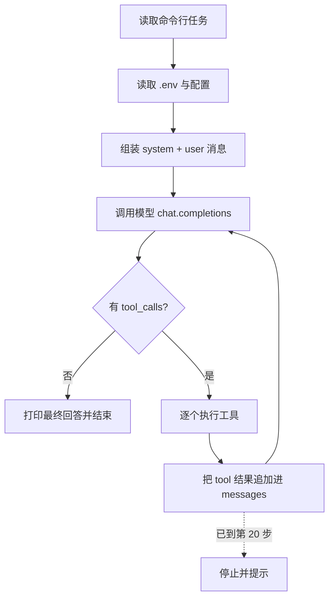

# 第 1 课：最小 Agent（`agent.js` 实现说明）

这份文档讲清楚 `lessons/lesson-01/agent.js` 每一段在做什么、为什么这么写。建议先读完本文，再打开 `agent.js` 对照看细节——整个文件只有 160 行。

## 先跑起来

```bash
# 项目根目录的 .env 里写好 API_KEY=你的模型密钥
node lessons/lesson-01/agent.js "在当前目录创建 hello.py，打印 hello，并运行它"
```

也可以换一个 OpenAI 兼容模型：

```bash
BASE_URL=https://api.example.com MODEL=your-model node lessons/lesson-01/agent.js "你的任务"
```

运行需要 Node.js 20.12+，因为用到了 `process.loadEnvFile` 和 `import.meta.dirname`。

## 一句话原理

Agent 并不神秘：**把“任务 + 可用工具说明 + 历史消息”发给模型；模型如果要调工具，就由代码去执行，再把执行结果追加回消息列表；如此循环，直到模型不再调工具。**

模型只负责“决定下一步做什么”，真正碰文件、跑命令的始终是 `agent.js` 里的普通函数。整份代码的核心，就是维护好下面这个 `messages` 数组：

```js
const messages = [
  { role: 'system', content: SYSTEM },
  { role: 'user', content: task },
  // 循环中不断追加：
  // { role: 'assistant', content, tool_calls }
  // { role: 'tool', tool_call_id, content }
];
```

`messages` 就是 Agent 的“短期记忆”。每转一圈，它都会变长，模型每次都能看到全部历史。四种角色各司其职：

| role | 作用 |
|---|---|
| `system` | 固定行为约束，只出现一次 |
| `user` | 用户任务 |
| `assistant` | 模型输出，可能带 `tool_calls` |
| `tool` | 工具结果，靠 `tool_call_id` 与对应的调用配对 |

## 整体流程



## 逐段对照

### 启动与配置（第 1–31 行、第 145–160 行）

- 第 19–23 行：用 `process.loadEnvFile` 读项目根目录的 `.env`。路径用 `import.meta.dirname` 拼成 `../../.env`，所以无论从哪个目录启动都能找到；没有 `.env` 时静默跳过，直接用 `export` 的环境变量也可以。
- 第 25–27 行：`MODEL` 默认 `deepseek-flash`；`MAX_STEPS = 20` 是防死循环的硬上限；`execAsync` 把回调式的 `exec` 包成 Promise。
- 第 29–31 行：`SYSTEM` 提示词只交代两件事——需要时调工具，任务完成后用文字总结、别再调工具。后半句很重要，它是循环能正常结束的前提。
- 第 145–153 行：先校验命令行任务和 `API_KEY`，缺了就打印一句人话并退出，避免抛 SDK 堆栈。
- 第 155–160 行：创建指向 DeepSeek 的 OpenAI 兼容客户端，执行 `run()`，最后关掉 readline。

注意执行顺序：`runShell` 在第 44 行引用了 `ask`，而 `ask` 到第 136 行才定义。之所以没问题，是因为 `runShell` 只在最后 `await run(...)` 时才真正被调用，那时模块早已初始化完毕。

### 工具：就是普通的 async 函数（第 34–59 行）

三个工具都没有任何框架包装：

| 工具 | 实现 | 返回值 |
|---|---|---|
| `read_file` | `fs.readFile(p, 'utf8')` | 文件内容 |
| `write_file` | `fs.writeFile(p, content, 'utf8')` | `已写入 xxx（N 字符）` |
| `run_shell` | 确认后 `execAsync(command)` | 命令输出（截断到 4000 字符） |

几个细节值得注意：

- **`run_shell` 是第 1 课唯一的权限控制**：每条命令都通过 `ask()` 问 `y/n`，回答不是 `y` 就返回 `用户拒绝执行该命令`，模型会把这个字符串当成工具结果继续处理。
- **超时和输出上限**：`timeout: 60_000` 防止命令卡死，`maxBuffer: 64 * 1024 * 1024` 防止输出过大撑爆内存。
- **结果只保留最后 4000 字符**：命令输出可能非常长，而它要进入模型上下文，截断是最便宜的上下文保护。
- **出错不抛异常**：命令非零退出时，`catch` 返回 `[exit code]` 加输出；工具出错的信息会作为 `tool` 消息交给模型，让它自己修正，而不是让整个 Agent 崩掉。
- **`TOOL_FUNCS` 是一张“名字 → 函数”的表**，循环执行工具时靠它分发。

注意：第 1 课只确认 shell 命令，`write_file` 和 `read_file` 是直接执行的；也没有工作区边界，`path` 传 `../..` 也能读写。这些限制到第 3 课才补上。

### 工具说明：给模型看的 JSON Schema（第 61–81 行）

模型并不知道本地有哪些函数，必须靠一份“说明书”告诉它。`tool()` 工厂把 `{ 参数名: 参数说明 }` 转成 OpenAI 的 function calling 格式：

```js
tool('write_file', '写入文件（覆盖）', {
  path: '文件路径',
  content: '完整文件内容',
})
```

生成的 schema 里所有参数都是 `string`，并且全部 `required`。这是刻意简化的结果：够用，但表达不了数字、枚举、可选参数。

`TOOLS` 是给模型看的“菜单”，`TOOL_FUNCS` 是代码真正能执行的“后厨”。两张表必须同名、同参数——这也是第 2 课要把它们合并成统一注册表的原因。

### 核心循环（第 83–118 行）

`run()` 只有四件事：

1. **准备消息**：`system` + 用户任务。
2. **调用模型**：每次请求都带上 `messages` 和 `tools`。
3. **判断是否结束**：`msg.tool_calls` 为空，说明模型认为任务完成，打印回答并 `return`。
4. **执行工具并回填**：对每个 `tool_call` 解析 JSON 参数、查表、执行，然后把 `{ role: 'tool', tool_call_id, content }` 追加进 `messages`。

下面几点是这段代码的正确性关键：

- **每个 `tool_call` 都必须有一条对应的 `tool` 消息**，且 `tool_call_id` 要和模型返回的 `id` 一致，否则下一轮请求会被 API 拒绝。模型一轮里可能请求多个工具，所以内层用的是 `for...of`，逐个执行、逐个回填。
- **工具执行是串行的**，即便模型一次返回多个调用，也是按顺序 `await`，并没有并行。
- **参数解析失败、工具抛异常、工具名不存在**，都会被 `try/catch` 包住并转成字符串结果，模型下一轮能看到错误并重试。
- **`MAX_STEPS` 是兜底**：模型如果反复调工具停不下来，循环到第 20 步就退出，避免无限消耗 token。这是“循环”而不是“递归”，所以不存在调用栈溢出的问题。

### `assistantMessage`：把 SDK 对象变回普通消息（第 120–132 行）

模型返回的 `message` 带有 SDK 自己的对象结构，直接塞回 `messages` 可能夹带额外字段。这个函数把它整理成请求所要求的普通对象：

- `content` 用 `?? null`：有工具调用时 `content` 常常是 `null`，必须保留 `null` 而不是变成 `undefined`。
- 把 `tool_calls` 只保留 `id`、`type`、`function.name`、`function.arguments` 四项，丢掉 SDK 附加的其他属性。
- 保留 `reasoning_content`：部分模型会返回该字段，原样回传可让后续请求延续模型自己的推理上下文。
- 工具调用的历史必须完整回传，模型才能把“自己上一轮要做什么”和“工具返回了什么”对上。

### 终端确认的 readline（第 134–143 行）

`ask()` 懒加载并复用同一个 readline 实例，所有确认框共用，避免反复创建接口，也避免多个读取器抢 stdin。如果 stdin 已关闭（比如管道输入结束），`question()` 会抛错，这里吞掉并返回空字符串，等价于“没有回答 / 拒绝”。

## 一次任务的消息演化

以“创建 `hello.py` 并运行”为例，`messages` 大致会这样增长（实际步数取决于模型，可能把写入和运行合并到一轮）：

```text
system     你是一个能操作本地文件和命令行的编程助手……
user       在当前目录创建 hello.py，打印 hello，并运行它
assistant  tool_calls: write_file({ path: "hello.py", content: "print('hello')" })
tool       已写入 hello.py（14 字符）
assistant  tool_calls: run_shell({ command: "python3 hello.py" })
tool       hello
assistant  已创建并运行 hello.py，输出为 hello。
```

最后一条没有 `tool_calls`，循环结束，终端打印：

```text
[完成，共 3 步]
已创建并运行 hello.py，输出为 hello。
```

如果模型在第 1 步就直接回答、不调工具，那也算完成——循环的判断标准始终是“有没有工具调用”，而不是“任务是否真的做完了”。模型判断失误时，第 1 课没有额外校验，这也是教学版的边界之一。

## 设计取舍

这一课刻意保持最小，方便看清主干：

- **不引入任何 Agent 框架**，只依赖 `openai` 一个包；循环、工具分发、消息拼装都手写。
- **工具结果统一是字符串**：模型只能读文本，字符串最简单；错误也走同一条通道，不需要单独的错误协议。
- **没有抽象注册表**：三个工具直接写死，读起来最短。第 2 课才抽出 `tools.js`。
- **单轮执行**：一个进程只处理一个任务，跑完就退出。第 2 课改成可连续对话的 REPL。
- **只确认 shell**：教学上先展示“人工确认”这个机制，完整性留给后续课程。

## 边界与下一课

第 1 课能跑通，但还不能放心日常使用：

- 没有工作区限制，文件工具可以读写任意路径；
- 没有危险命令黑名单，只靠每条命令人工确认；
- 上下文无限增长，只有工具结果做了 4000 字符截断；
- 没有会话持久化、技能、渠道、定时、MCP、子 Agent、计划、记忆。

第 2 课先把“工具注册表 + 统一执行器”抽出来，让主循环不再认识任何具体工具；之后每课加一个能力。完整路线见[项目 README](../../README.md)的课程表。

## 安全提醒

这是教学代码，Agent 会真的执行命令、读写文件。第 1 课的确认机制只能防手滑，**不是沙箱**：`run_shell` 没有黑名单，`write_file` 甚至不需要确认。请在专门的目录里运行，不要把当前目录指向主目录或重要项目。
